# Ejemplos renderizados

Los siete fragmentos de `skills/diagram/examples/` tal y como los pinta un documento Delphos, en tema claro y oscuro. Se generan con Playwright sobre las hojas del sistema de diseño (las de `system/` de este repo); no son parte del plugin que se instala, solo muestran el resultado.

| Tipo | Claro | Oscuro |
|---|---|---|
| Flujo (`flowchart.html`) | 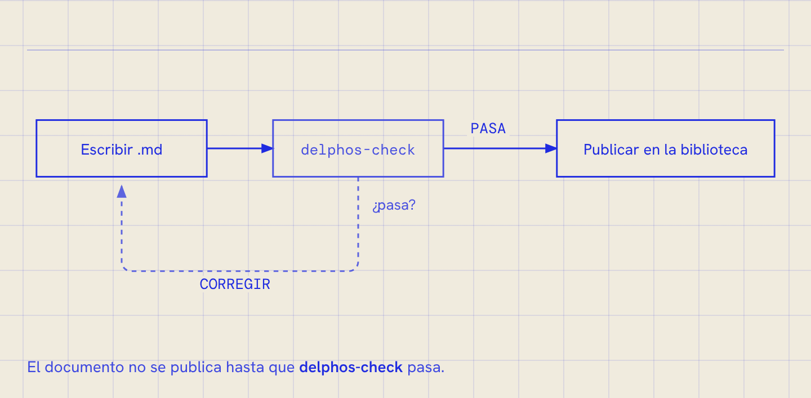 | 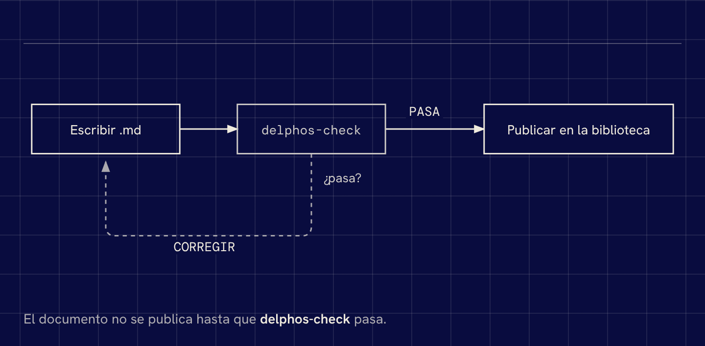 |
| Secuencia (`sequence.html`) | 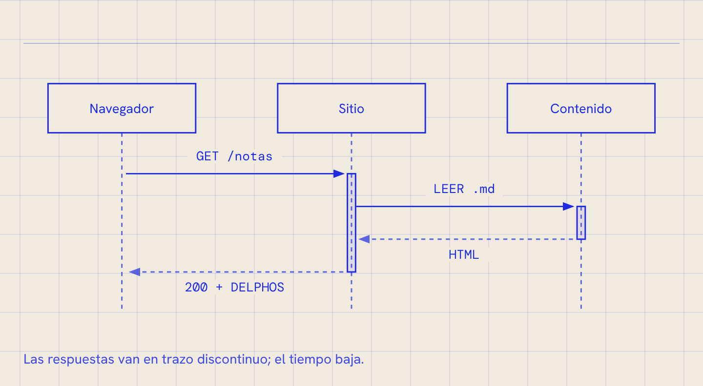 | 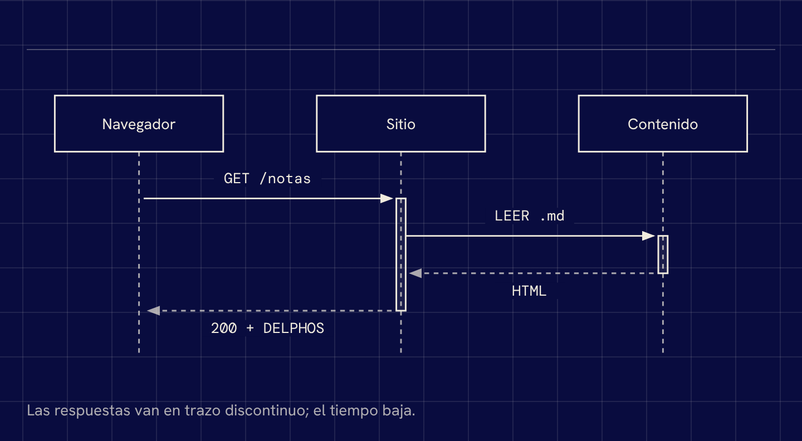 |
| Estados (`state.html`) | 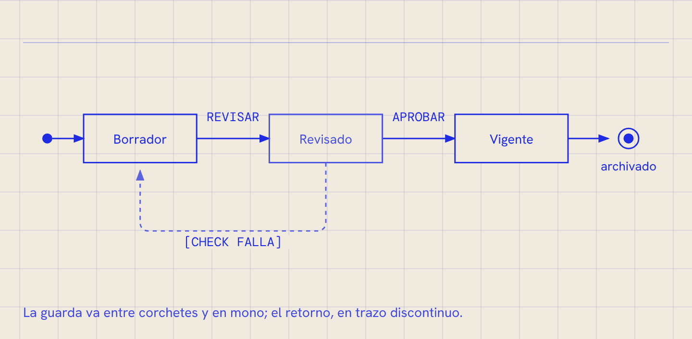 | 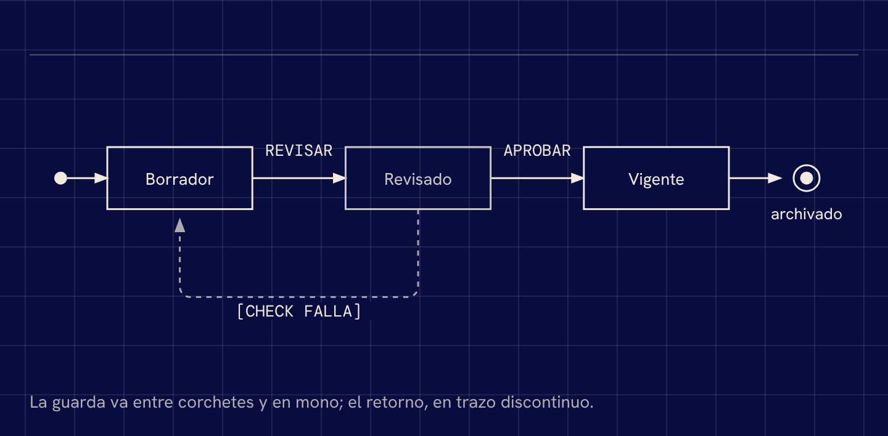 |
| Arquitectura (`architecture.html`) | 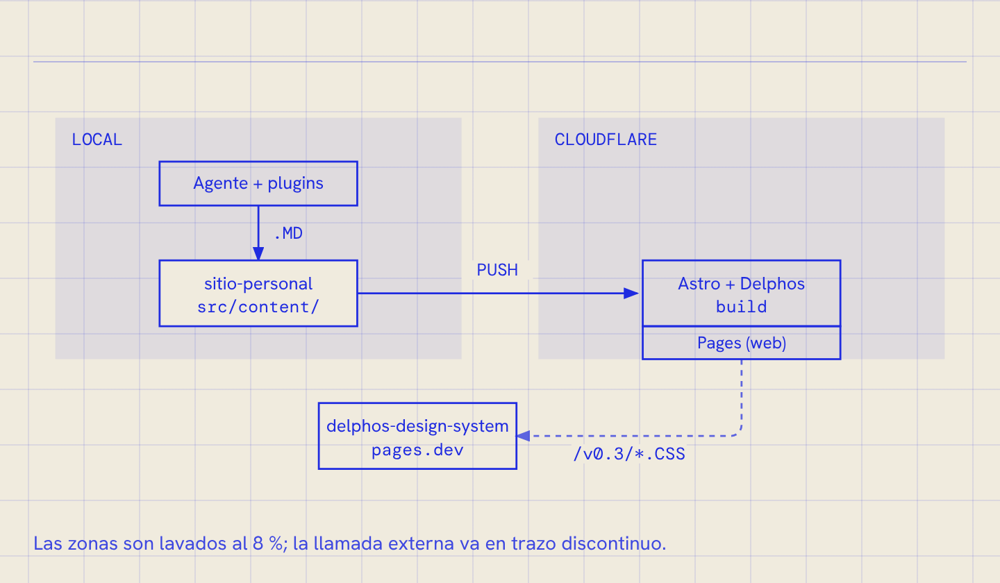 | 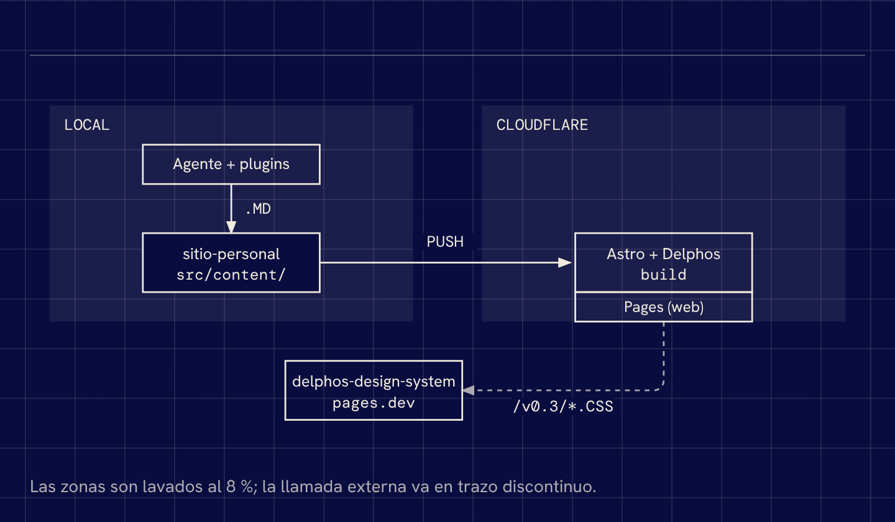 |
| Línea de tiempo (`timeline.html`) | 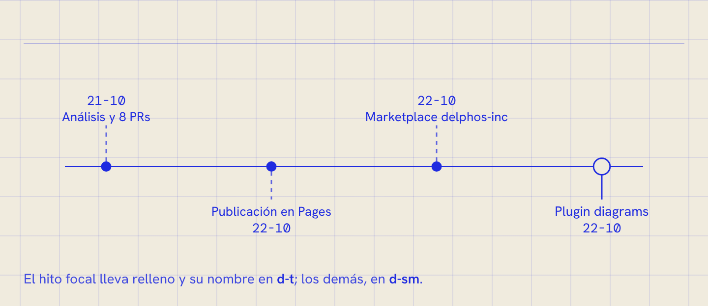 | 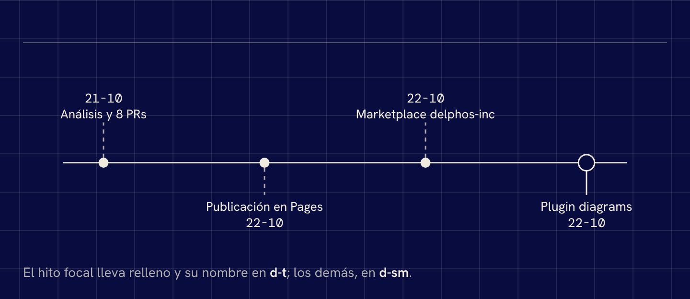 |
| Barras (`bar.html`) | 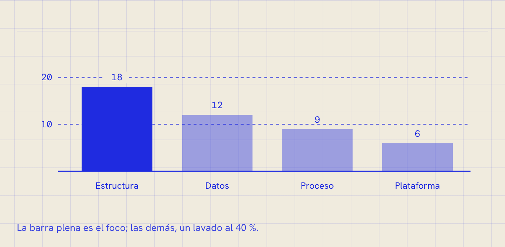 | 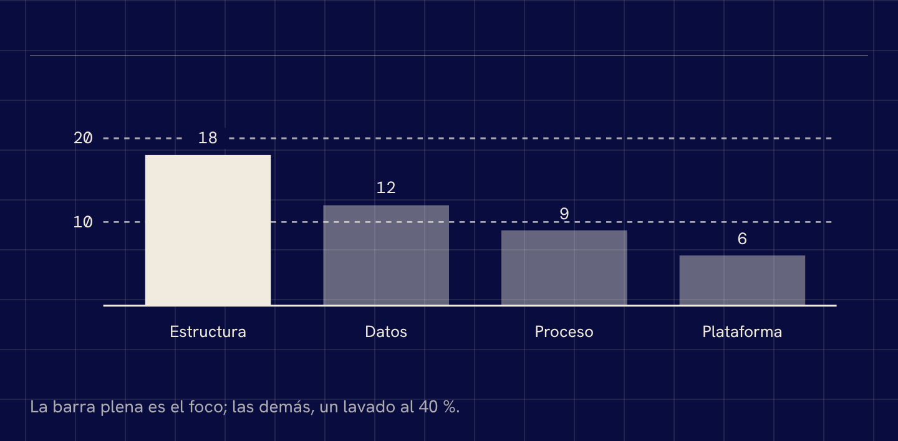 |
| Mapa de calor (`heatmap.html`) | 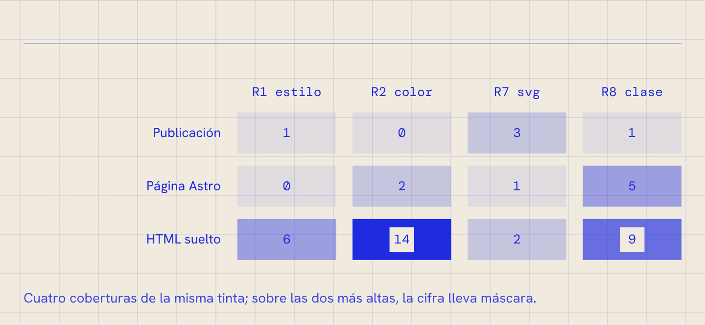 | 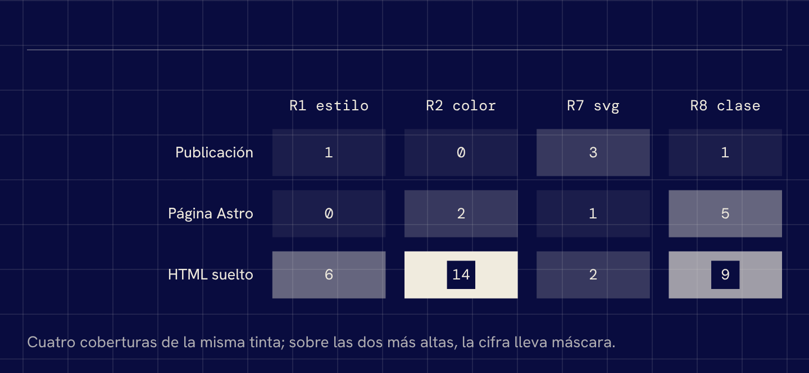 |
